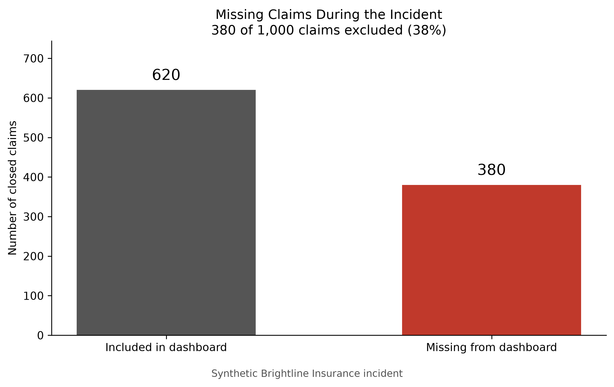
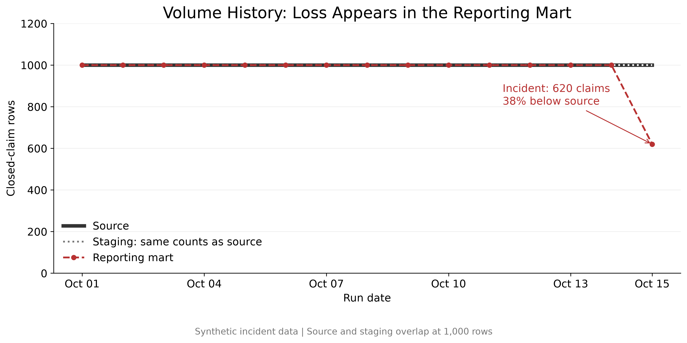
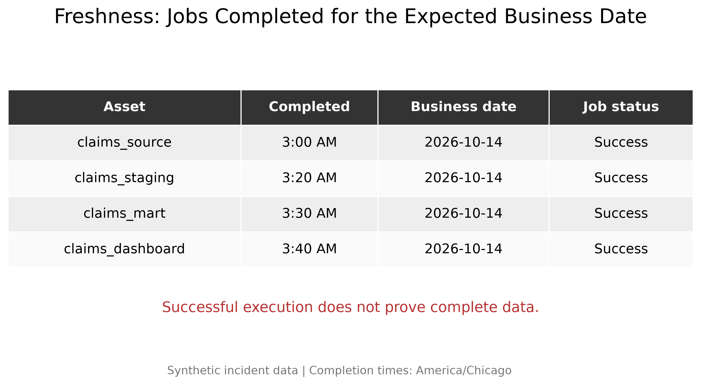
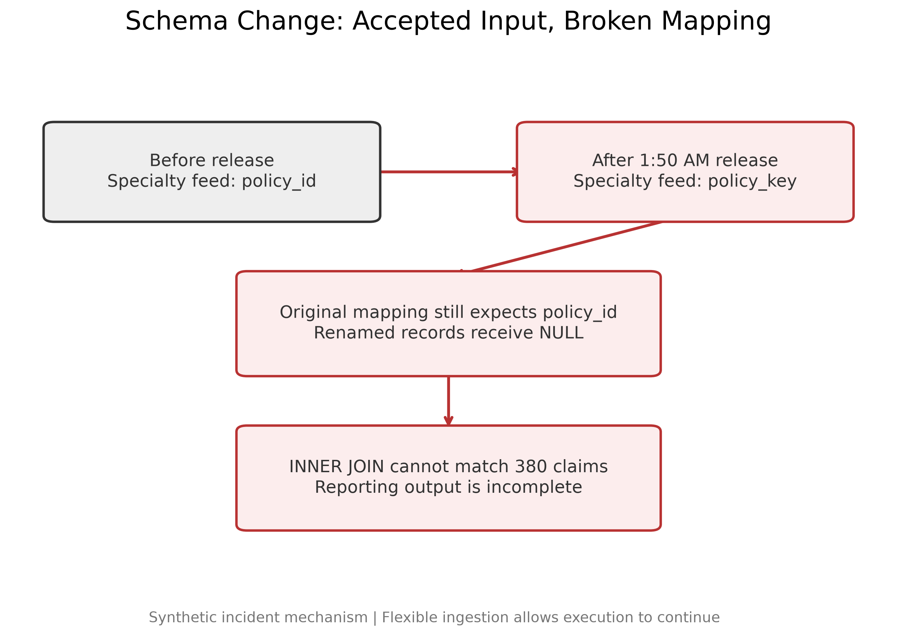
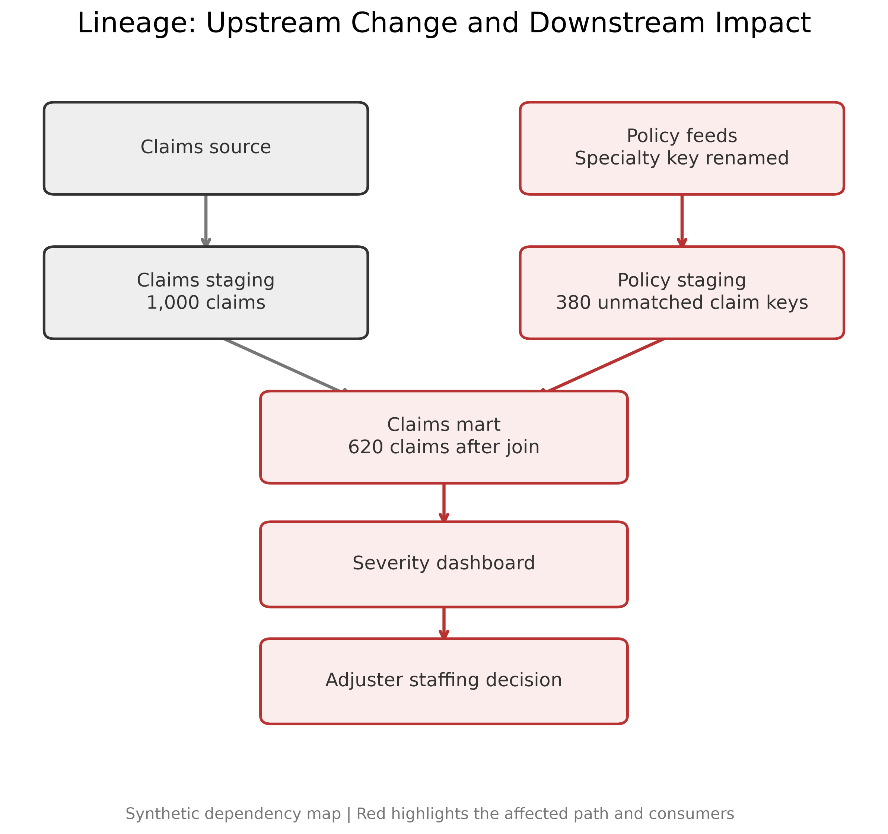
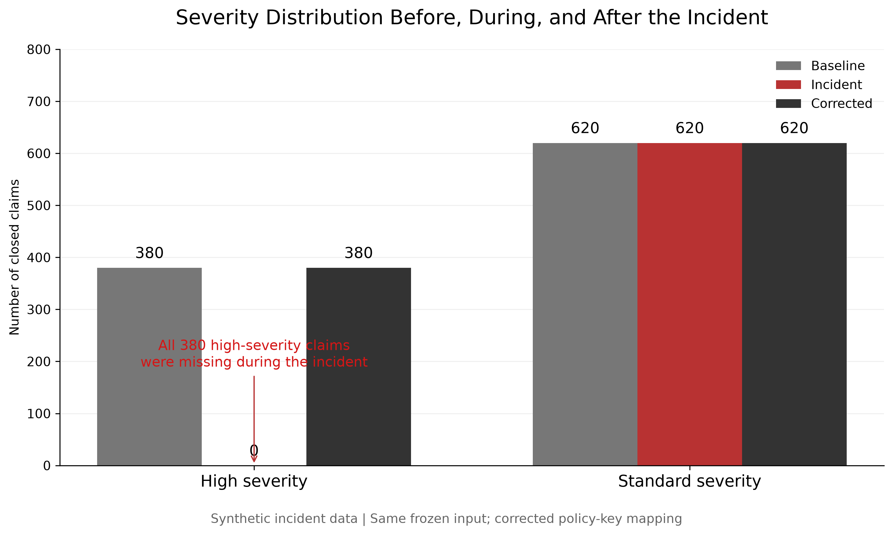

# Brightline Incident

A reproducible, fully synthetic data-quality incident for CST 660 (Agile DataOps), Week 6.

Brightline Insurance is a fictional company. An upstream schema change silently drops every high-severity claim from the reporting mart, and every pipeline job still reports success. This project generates the incident data, shows how the failure happened, and checks that a one-line mapping fix restores the missing rows.

> All data, timestamps, and figures in this project are synthetic.

## The incident at a glance

| Run       | Mart rows | High-severity claims | Standard claims | Mean severity | Unmatched claims |
|-----------|----------:|---------------------:|----------------:|--------------:|-----------------:|
| Baseline  | 1,000     | 380                  | 620             | 4.9           | 0                |
| Incident  | 620       | **0**                | 620             | 3.0           | **380**          |
| Corrected | 1,000     | 380                  | 620             | 4.9           | 0                |

**What happened (Oct 15, 2026):**

1. **1:50 AM:** The specialty policy feed renamed `policy_id` to `policy_key`. Downstream teams were not told.
2. Ingestion accepted the new field. Because the original mapping still read `policy_id`, every specialty record got a `NULL` key.
3. The claims mart is built with an `INNER JOIN` on `policy_id`, so all 380 specialty (high-severity) claims fell out of it.
4. Every job finished on time for the expected business date. Freshness checks passed and nothing alerted.
5. The severity dashboard showed **0 high-severity claims**, and that number fed the adjuster staffing decision.

**Root cause:** a breaking schema change that flexible ingestion let through, combined with a mapping that did not handle the renamed field.

**Fix:** if `policy_id` is missing, fall back to `policy_key`. Rerunning the same frozen input and the same SQL with this corrected mapping brings back all 1,000 claims.

**Main lesson:** a job that runs successfully has not proven that its data is complete. Freshness checks alone missed this incident. Volume, distribution, and join-integrity checks would have caught it.

## Project structure

```
.
├── brightline_incident.py        # Generates the synthetic incident and all output data (Python script)
├── visualize_incident.py      # Charts 01–04: volume, freshness, schema change, lineage
├── visualize_severity.py      # Chart 05: severity distribution before / during / after
├── visualize_claims.py        # Bar chart of included vs. missing claims
└── output/
    ├── claims_source.csv            # 1,000 closed claims (380 High, 620 Standard)
    ├── policy_feed_before.json      # Policy feed before the schema change
    ├── policy_feed_incident.json    # Policy feed after the rename (specialty rows use policy_key)
    ├── incident_mart.csv            # Claims mart during the incident (620 rows)
    ├── corrected_mart.csv           # Claims mart with the corrected mapping (1,000 rows)
    ├── distribution_profiles.csv    # Row count, severity mix, and mean for each run
    ├── join_checks.csv              # Unmatched claims and policy_id null rate
    ├── volume_history.csv           # 14 normal daily runs plus the incident run
    ├── freshness.csv                # Job completion times for each asset
    ├── schema_changes.csv           # Log of the upstream schema change
    ├── lineage.md                   # Mermaid lineage graph
    └── visuals/                     # Rendered PNG charts
```

## How it works

`brightline_incident` uses an in-memory SQLite database and runs the same pipeline three times:

| Run       | Policy feed       | Mapping   | Purpose                                     |
|-----------|-------------------|-----------|---------------------------------------------|
| Baseline  | Before the change | Original  | Normal behavior                             |
| Incident  | After the change  | Original  | Reproduces the failure                      |
| Corrected | After the change  | Corrected | Counterfactual: proves the fix is enough    |

Only the mapping changes between the incident run and the corrected run. The input data and the mart SQL are identical, so the corrected mapping alone accounts for the recovered rows.

## Getting started

### Requirements

- Python 3.10+
- `matplotlib` (only the visualization scripts need it; the generator uses just the standard library)

### Setup

```bash
python3 -m venv .venv
source .venv/bin/activate        # Windows: .venv\Scripts\activate
pip install matplotlib
```

### Run

Run these from the project root. The generator writes to `./output` relative to the current directory.

```bash
# 1. Generate the synthetic incident data
python brightline_incident.py

# 2. Build the charts
python visualize_incident.py     # 01–04 → output/visuals/
python visualize_severity.py     # 05    → output/visuals/
python visualize_claims.py       # missing-claims bar chart → output/
```

`visualize_severity.py` and `visualize_claims.py` open a chart window when they finish. Close it to end the script.

## Visuals

| Chart | What it shows |
|-------|---------------|
|  | 380 of 1,000 claims (38%) were left out of the dashboard |
|  | Source and staging stay at 1,000 rows; the mart drops to 620 on the incident date |
|  | Every job finished on time, so freshness checks gave no warning |
|  | How the rename produced NULL keys and broke the join |
|  | The affected path from the policy feed to the staffing decision |
|  | High-severity claims vanish during the incident and return after the fix |

## Recommended controls

Checks that would have caught this incident before it reached the dashboard:

- **Volume reconciliation:** alert when mart row counts diverge from staging (here, 1,000 vs. 620).
- **Distribution monitoring:** alert when a category disappears (`severity_cardinality` fell from 2 to 1) or when a share or mean shifts sharply.
- **Join integrity:** alert when the number of unmatched keys or the null rate of a join key rises above zero.
- **Schema contracts:** treat a column rename as a breaking change, require downstream notification, and fail ingestion rather than filling the old field with `NULL`.
- **Lineage-aware alerting:** use the lineage graph to notify the owners of the dashboard and the staffing decision.

## Author

Jeanee Allen · CST 660 Agile DataOps · Concordia University, St. Paul
